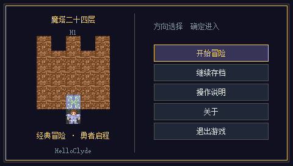
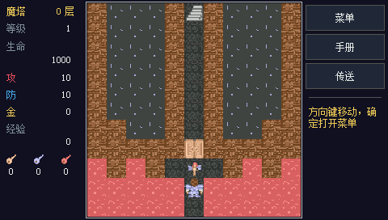
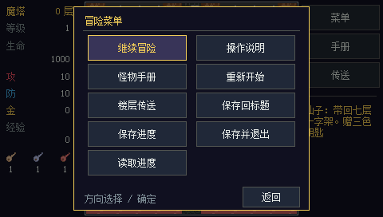
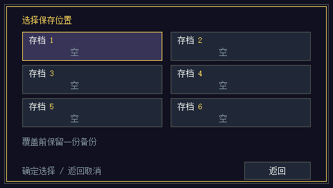

# 魔塔24层 · BBK H1 原生版


面向 **步步高 H1 / Y100 V1.41、480×272 横屏** 的原生 BDA 游戏。作者：**HelloClyde**。

移植自 [BBK9588-mota24](https://github.com/HelloClyde/BBK9588-mota24) 的 `0.1.0-alpha.6`，保留地图、战斗规则、剧情、隐藏路线、怪物手册、楼层传送和六槽存档。界面按 H1 的宽屏重新布局：左侧状态、中央地图、右侧功能与提示；移动、确定和返回使用实体键，游戏画面没有虚拟方向键或确定／返回软键。

这是非官方适配，剧情为小屏改写，没有原版音乐和滚动影片。当前版本已在 H1 V1.41 完整固件模拟器中验证启动、实体按键、触摸、存取档及退出，尚未做物理 H1 真机验证。具体范围与受测 BDA 哈希见 [验证记录](docs/verification.md)。

## 快速开始

1. 在 [Releases](https://github.com/HelloClyde/BBKH1-mota24/releases) 查看发布版本，下载 `H1Mota.bda` 或 `H1Mota-install.zip`。尚无可用发行版时，按下面的源码构建步骤生成。
2. 将 `H1Mota.bda` 复制到设备的 `应用/程序/` 目录。安装 ZIP 已包含 `应用/程序/H1Mota.bda`，解压后将其中的 `应用` 文件夹合并到设备根目录。
3. 返回设备桌面，在游戏分类中打开“魔塔24层”，选择“开始冒险”或“继续存档”。
4. 用实体方向键移动，确定键确认，返回键打开或关闭冒险菜单。对话可用确定键或点击对话框逐页推进。

图标、地图、字模和游戏素材已内置，无需另放资源文件。此 BDA 面向 H1 / Y100 V1.41，不适用于 9588。

### 操作

| 输入 | 功能 |
| --- | --- |
| 实体方向键 | 移动、选择；按住方向键可连续行走 |
| 确定 / Enter / 空格 | 确认；探索时打开菜单；战斗时快速结算 |
| 返回 / Escape | 打开或关闭菜单、取消、跳过片头 |
| B / M / F | 打开怪物手册 / 菜单 / 楼层传送 |
| 点击右侧功能按钮 | 打开菜单、怪物手册或楼层传送 |
| 点击角色相邻格子 | 行走一步并交互 |
| 点击菜单、存档、对话 | 选择或继续 |

手册和传送需要取得相应道具后使用。战斗逐回合显示双方攻击、血量与胜利奖励，快速结算不改变伤害规则。通过菜单的“保存并退出”返回设备桌面；标题页的“退出游戏”直接退出。

### 存档与迁移

存档目录为 `A:\H1MOTA\`，包含 `SLOT1.SAV` 至 `SLOT6.SAV`。保存、覆盖和读取均需确认。覆盖前保留 `.BAK`，写入临时文件及正式文件后读回校验；主文件损坏时尝试备份。备份进度时请保留整个文件夹；这一机制不承诺掉电原子性。

保留原 9588 版的 6608 字节存档结构。迁移时，将一个有效旧存档复制为 H1 根目录的 `MOTA24.SAV`（也支持 `MOTA24.BAK`），在“继续存档”中选择“导入旧档”，随后保存到六个新槽位之一。导入入口只读取旧文件。

### 从源码构建

以下命令在 Windows 的 PowerShell 中运行，需要 Git、Python 和可从 `PATH` 调用的主机 `gcc`：

```powershell
git clone --recurse-submodules https://github.com/HelloClyde/BBKH1-mota24.git
cd BBKH1-mota24
python -m pip install -r requirements.txt
python tools/install_toolchain.py
python tools/test.py
python tools/build.py
```

已有检出可运行 `git submodule update --init sdk`。工具链安装器将设备编译器放入 `.tools/toolchain/bin`，构建默认使用仓库内的 `sdk/` 子模块。已有环境可通过 `python tools/build.py --sdk PATH --toolchain PATH` 指定 SDK 和工具链目录；主机测试可通过 `python tools/test.py --cc PATH` 指定主机 C 编译器。

主要输出为 `dist/H1Mota.bda`、`dist/H1Mota-install.zip` 及对应校验文件；`build/H1Mota.elf` 用于本地调试。默认构建直接使用已提交的地图、像素和字模数据，不需要本机安装宋体或重新生成资源。

## 截图

以下截图来自 **H1 V1.41 完整固件模拟器**，原始分辨率为 **480×272**。具体受测 BDA 与操作记录见 [验证记录](docs/verification.md)。

| 标题 | 地图 |
| --- | --- |
|  |  |

| 冒险菜单 | 六槽存档 |
| --- | --- |
|  |  |

11×11 地图使用 24×24 正方形格子，完整地图为 264×264 像素。原有 20 像素素材按最近邻等比例放大；标题、剧情、商店、手册、战斗、帮助、存档和确认页面也按横屏重排。

## 依赖

| 用途 | 依赖 |
| --- | --- |
| 运行成品 | H1 / Y100 V1.41，480×272；无需 Python 或外置图片 |
| 构建 | Windows、Git、Python（本地 3.11.5，CI 3.12），以及 `requirements.txt` 固定的 Pillow 12.3.0、pyelftools 0.33 |
| SDK | [bbk-h1-bda-sdk](https://github.com/MrDefinition1999/bbk-h1-bda-sdk)，固定子模块提交 `067fe072477861dfc8949d7b1a55279fb92d2548` |
| 设备工具链 | `mipsel-none-elf` GCC 15.2.0，由 `tools/install_toolchain.py` 安装 |
| 主机回归 | 可运行的 GCC（CI 使用 MSYS2 UCRT64 GCC），使用 `python tools/test.py` |
| 补充字模（可选） | Pillow，以及自行提供且有权使用的字体，通过 `python tools/update_font.py --font PATH` 指定 |
| 完整固件验证（可选） | H1 固件模拟环境及自行准备的固件、NAND；这些文件不随仓库分发 |

构建与验证入口面向 Windows。其他开发平台及其他设备不在当前验证范围内。SDK 和工具链各自遵循其许可证。

## 开发与验证

`tools/test.py` 编译并运行核心规则、UI、战斗、存档及渲染五组主机回归，使用与设备版相同的 C 代码。渲染测试将页面导出至 `build/screenshots/`，这些图片属于主机渲染结果。主机测试不替代完整固件或真机验证，也不代表正常数值下已全程通关。

GitHub Actions 配置 main、拉取请求和手动构建；版本标签用于发布 BDA、安装包和校验信息。CI 的自动构建与主机回归不包含私有固件。每个版本实际完成的验证以 [docs/verification.md](docs/verification.md) 和相应 Actions 结果为准。

## 感谢

- 作者：**HelloClyde**。
- 感谢：**QQ 群「步步高电子词典游戏群」**，群号：**830340878**。
- 感谢 [BBK9588-mota24](https://github.com/HelloClyde/BBK9588-mota24) 原工程、BBK H1 BDA SDK 与模拟器相关工作。
- 原游戏：胖老鼠工作室《24层魔塔》；地图、数值与像素素材参考 Mota Mod 的复刻版本，发布者大化术士。

## 许可证与来源

自编写的应用与构建、测试代码按 [Apache-2.0](LICENSE) 开源。第三方地图、像素素材及字模不自动适用该许可；当前没有取得这些第三方内容可核验的独立开源许可证。来源、具体许可边界和缺项见 [SOURCES.md](SOURCES.md) 与 [NOTICE](NOTICE)。仓库不包含设备固件、NAND、个人存档或完整字体文件。
